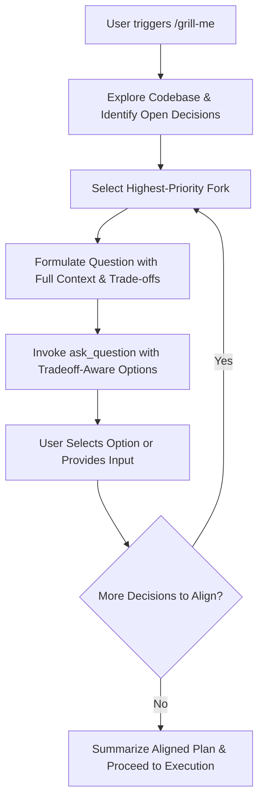

# Interactive Alignment & Design Decision Grilling (`/grill-me`)

The `/grill-me` skill conducts a disciplined, consultative interview to resolve ambiguous requirements and architectural forks before code is written or plans are finalized.

Instead of presenting cryptic choices where the user has to guess or blindly trust the `(Recommended)` tag, every question must be framed with rich context, explicit trade-offs, and clear rationale for each option.

---

## 1. Golden Rules of Grilling

1. **Investigate Before Asking**: Inspect the codebase first. Never grill the user on facts that can be determined by reading existing files, config files, package dependencies, or git history.
2. **Context First, Options Second**: Always explain *why* this decision point is critical, what technical dilemma it addresses, and how it impacts the project long-term.
3. **Transparent Trade-offs for Every Option**: For every option (including non-recommended ones), explicitly detail the pros, cons, and operational/developmental trade-offs (e.g., complexity, performance, scalability, developer experience, bundle size, latency, security).
4. **Demystify the "(Recommended)" Tag**: Never slap `(Recommended)` on an option without explaining *why* it was recommended for this specific project and codebase over the alternatives.
5. **Inline Option Summaries**: In the `options` array itself, include an inline summary/tagline explaining the differentiator so options are clear at a glance in the selection UI.
6. **One Focus at a Time**: Ask one focused question (or tightly coupled decision pair) per turn. Do not overwhelm the user with a massive multi-question survey.
7. **Iterative Convergence**: Build on previous answers. After the user answers a question, briefly acknowledge their choice and transition naturally to the next architectural fork until all major decisions are aligned.

---

## 2. Question Formatting Standard

When formulating a question for the `ask_question` tool or conversational prompt, follow this structure in the `question` field:

### Template

```markdown
### Decision: [Clear, Descriptive Title of the Decision]

**Context & Dilemma:**
[2-3 sentences explaining the technical problem, why this architectural fork matters now, and any constraints found in the codebase.]

---

#### Options & Trade-Off Analysis:

* **Option 1 (Recommended): [Name/Approach]**
  * **Concept:** [Brief explanation of how this approach works.]
  * **Pros:** [Key benefits: performance, simplicity, maintainability, DX.]
  * **Cons / Trade-offs:** [Downsides: potential limitations, migration cost, tech debt.]
  * **Why Recommended:** [Explicit rationale comparing it directly against other choices for this repo.]

* **Option 2: [Name/Approach]**
  * **Concept:** [Brief explanation of how this approach works.]
  * **Pros:** [Key benefits.]
  * **Cons / Trade-offs:** [Key drawbacks.]
  * **Best Suited For:** [When the user should prefer this option instead.]

* **Option 3: [Name/Approach]** *(if applicable)*
  * **Concept:** [Brief explanation.]
  * **Pros:** [Key benefits.]
  * **Cons / Trade-offs:** [Key drawbacks.]
  * **Best Suited For:** [When the user should prefer this option instead.]

---
Which direction aligns best with your goals?
```

---

## 3. Option Text Formulation

In the `options` argument of `ask_question`:
- **Do NOT provide bare labels**: Avoid `["(Recommended) Zustand", "Redux Toolkit", "React Context"]`.
- **DO provide descriptive, tradeoff-aware labels**:
  - Prefix the recommended option with `(Recommended)`.
  - Append a concise 1-line distillation of its primary trade-off and value proposition.

### Example Options Array:
```json
[
  "(Recommended) Zustand — Minimal boilerplate (3kB), hook-based, perfect for lightweight UI state without provider nesting",
  "Redux Toolkit — Full action tracing and time-travel devtools, but heavier bundle size and more ceremonial boilerplate",
  "React Context + Hooks — Zero third-party dependencies, but risks unnecessary subtree re-renders if state changes frequently"
]
```

---

## 4. Workflow Stages



1. **Discovery**: Read the workspace, understand existing dependencies, existing conventions, and user goals.
2. **Prioritization**: Identify the top 2–4 architectural forks that cannot be inferred from the codebase.
3. **Execution**:
   - Deliver each question via `ask_question` with the rich trade-off breakdown.
   - Wait for the user's answer.
4. **Resolution**: Once all decisions are answered, provide a concise summary of all agreed architectural choices and transition to drafting or executing the implementation plan.
